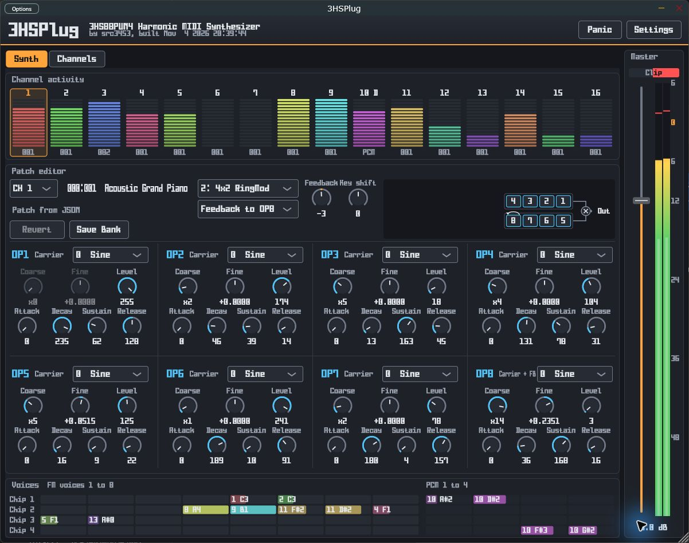
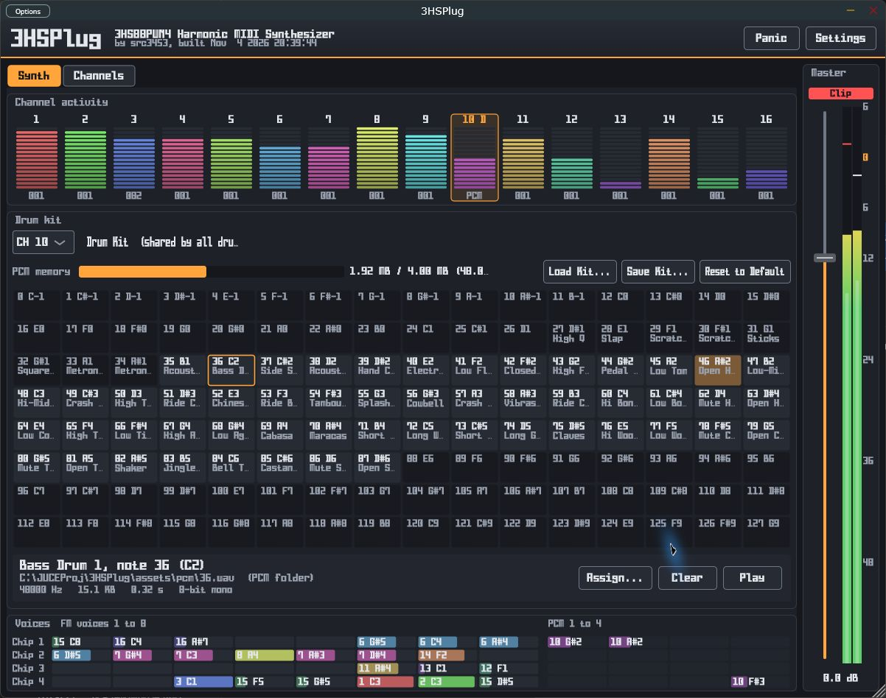
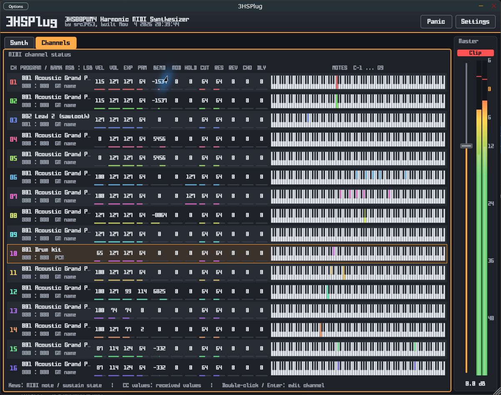

# 3HSPlug

**An eight-operator FM and PCM MIDI synthesizer, built with JUCE.**

3HSPlug brings the 3HS88PWN4 sound engine to your DAW or desktop. It combines editable FM patches, sample-based drums, and a live view of MIDI activity and voice allocation. The synthesizer uses the integer sound core shared with Furnace and CPT32.



*The updated standalone application receiving MIDI on Windows: channel activity, patch controls, algorithm routing, eight operator panels, voice allocation, and active stereo output meters.*

## Features

- Eight operators per FM voice, with waveform, coarse/fine tuning, level, and envelope controls.
- Thirteen modulation algorithms, adjustable feedback, and a selectable feedback destination.
- Sixteen MIDI channels with bank/program selection, pitch bend, sustain, and controller support.
- One to sixteen emulated chips: eight FM voices and four PCM voices per chip, for up to 128 FM voices and 64 PCM voices. The default is four chips.
- Live patch editing that also updates sounding voices, with JSON bank saving and patch reversion.
- A shared drum kit with per-note sample assignment, drag and drop, auditioning, and kit load/save.
- Channel activity monitoring, per-chip voice status, stereo peak/RMS metering, master volume, and a **Panic** button.
- Four built-in themes, custom JSON themes, and a choice of system or bundled fonts.
- Standalone and VST3 builds on Windows and macOS; Audio Unit on macOS.

## Get started

### Downloads and automated releases

Download packaged builds from [GitHub Releases](https://github.com/src3453/3HSPlug/releases).
Each ZIP includes the plugins, standalone application, patch banks, and PCM assets.
Windows builds are x64; macOS builds are Universal (arm64 and x86_64).

- **Release:** push a tag starting with `v`, such as `v0.0.1`. GitHub Actions builds and tests both platforms, then publishes the ZIPs with generated release notes. Re-running the workflow replaces assets for the same tag.
- **Nightly:** the [Nightly pre-release](https://github.com/src3453/3HSPlug/releases/tag/nightly) is updated after successful builds on `main` pushes and daily at 03:17 JST (18:17 UTC). You can also run the **Build** workflow manually on `main`. The rolling `nightly` tag and ZIPs are replaced with the built commit; nightly is marked as a pre-release and does not become the latest stable release.
- Pull requests build and test without publishing a release.

To publish a version after the workflow is on GitHub:

```sh
git tag v0.0.1
git push origin v0.0.1
```

Publishing uses the built-in `GITHUB_TOKEN`; no additional secret is needed.

### In a DAW

1. Build the plugin or unpack a distribution, then install the complete `3HSPlug.vst3` bundle in your host's VST3 location. On macOS, you can also install `3HSPlug.component` in your Audio Units location.
2. Rescan plugins and load **3HSPlug** as an instrument on a MIDI track.
3. Open **Settings → Asset folders**. Set **Patch folder...** to the supplied `assets/patches` folder and **PCM folder...** to `assets/pcm`.
4. Route MIDI notes to the instrument. Use channel 1 for a melodic part and channel 10 for drums.

Keep the asset folders in a stable location. Their paths are stored in plugin state and restored with your DAW project or plugin preset. Changing either folder reloads its contents; save your patch or kit edits first.

### Standalone

Launch `3HSPlug.exe` on Windows or `3HSPlug.app` on macOS. Use the JUCE **Options** menu to select an audio device and enable your MIDI input, then configure the asset folders as above.

To check the drum output without an external MIDI keyboard, select **CH 10**, choose a loaded drum note, and press **Play**.



*The drum kit editor during incoming MIDI playback, with active drum notes, voice allocation, and stereo output meters.*

### MIDI channel monitor

Open **Channels** to view all sixteen MIDI channels, including programs, banks, controller values, pitch bend, and a keyboard display of received notes and sustain state.



*The Channels view receiving MIDI, with per-channel status, highlighted notes, and active stereo output meters.*

## Edit sounds

Click a channel in **Channel activity**, or choose it from the editor's channel selector. For melodic channels, edit the modulation algorithm, feedback, key shift, and individual operators. The routing diagram identifies carriers and modulators.

**Save Bank** writes the current patch bank to its JSON file. **Revert** restores the selected patch from the file. Edits to a bank/program are shared by channels using that patch within the same plugin instance.

Selecting a drum channel opens the drum kit editor. Choose a note and use **Assign...**, drop an audio file onto a note, or press **Play** to audition it. **Load Kit...** and **Save Kit...** manage kit JSON files; all drum channels share the kit. PCM memory is limited to 4 MiB per chip.

Open **Settings** to change the number of chips, UI font, or theme. Appearance settings apply across instances on the same computer.

## Assets and configuration

The repository includes patch banks in `assets/patches` and drum samples in `assets/pcm`.

| Asset | Naming | Contents |
| --- | --- | --- |
| Patch banks | `<bank>.json`, bank 0–127 | A JSON object containing a `patches` array |
| Default drum samples | `<note>.wav`, note 0–127 | A sample mapped to that MIDI note |

You can also set asset directories before starting the application or DAW:

```powershell
$env:3HSPLUG_PCM_PATH = "C:\path\to\3HSPlug\assets\pcm"
$env:3HSPLUG_PATCHES_PATH = "C:\path\to\3HSPlug\assets\patches"
```

Without saved settings or environment variables, the defaults are `./pcm/` and `patches/`, relative to the host's working directory. Use the Settings controls for reliable setup in a DAW.

## Build from source

Requirements: CMake 3.22 or newer, a C++17 compiler, and JUCE in `lib/JUCE`. The CI workflow uses JUCE **8.0.8**. Windows builds require the Visual Studio C++ toolchain; macOS builds require Xcode command-line tools.

After cloning this repository, initialize dependencies:

```sh
git submodule update --init --recursive
```

If `lib/JUCE/CMakeLists.txt` is still missing, fetch the version used by CI:

```sh
git clone --depth 1 --branch 8.0.8 https://github.com/juce-framework/JUCE.git lib/JUCE
```

### Windows

Run from an x64 Visual Studio developer shell with CMake and Ninja available. A separate build directory avoids conflicts with the supplied Visual Studio preset.

```powershell
cmake -S . -B build/ninja -G Ninja -DCMAKE_BUILD_TYPE=Release
cmake --build build/ninja --parallel 4 --target 3HSPlug_Standalone 3HSPlug_VST3
```

Outputs are under `build/ninja/3HSPlug_artefacts/Release/Standalone` and `build/ninja/3HSPlug_artefacts/Release/VST3`.

### macOS

```sh
cmake -S . -B build-macos -DCMAKE_BUILD_TYPE=Release
cmake --build build-macos --parallel 4 --target 3HSPlug_Standalone 3HSPlug_VST3 3HSPlug_AU
```

Outputs are under `build-macos/3HSPlug_artefacts/Release/`. For a universal build, add `-DCMAKE_OSX_ARCHITECTURES="arm64;x86_64"` when configuring.

### Regression tests

```sh
cmake -S test -B build/s3hs-tests
cmake --build build/s3hs-tests --config Release
ctest --test-dir build/s3hs-tests -C Release --output-on-failure
```

See [test documentation](test/README.md) for coverage of core behavior and patch loading.

## Sound engine notes

The core runs at 48 kHz and uses Catmull–Rom interpolation for other host sample rates. PCM filtering and FM user waveforms A–D are currently omitted; those FM user waveforms produce silence. The legacy frequency-quantization setting has no effect with the integer core.

## Further documentation

- [Asset folder configuration](README_AssetPaths.md) (Japanese)
- [Themes and fonts](README_Themes.md) (Japanese)
- [Sound core integration](README_S3HS.md) (Japanese)
- [Vendored core provenance and update procedure](src/s3hs_core/3hs/README.md)
- [External patch editor](tools/README_patch_editor.md)
- [Genetic patch generation tools](tools/genetic_patch/README.md)

## License

See [LICENSE](LICENSE) for the repository's GNU General Public License version 2 text. JUCE and other included components retain their respective license notices.
